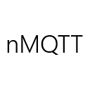

# 

**nMQTT** is a .NET client library for the [MQTT v3.1](http://mqtt.org/) messaging
protocol. It implements the MQTT publish/subscribe wire protocol over TCP and exposes
incoming messages as **Reactive Extensions (Rx) observable sequences**, so a subscription
behaves like any other `IObservable<T>` — composable, lazy, and disposable.

> ⚠️ **Legacy project.** nMQTT targets **.NET Framework 4.0 Client Profile** (Visual
> Studio 2012 era, `ToolsVersion=4.0`). It is **not** a .NET Core / .NET 5+ library and
> will not build with the modern `dotnet` CLI — use the classic `msbuild` / Mono toolchain.
> This repository is a mirror of the upstream project at
> [github.com/markallanson/nmqtt](https://github.com/markallanson/nmqtt); all credit goes to
> **Mark Allanson & Contributors**.

## What / Why

- A pure-C# MQTT v3.1 client: connect, publish, subscribe, ping, graceful disconnect.
- **Rx-based subscriptions** instead of the callback/event model used by most MQTT clients:
  `MqttClient.ListenTo(...)` returns an `IObservable<MqttReceivedMessage<T>>`.
- Pluggable payload converters (`IPayloadConverter<T>`) translate between raw bytes and your
  own types — `AsciiPayloadConverter` and `PassThroughPayloadConverter` ship in the box.
- Synchronous connection with keep-alive pings; no async/await connection model.

Supported QoS: **0 (At most once)** and **1 (At least once)** per the package release notes.
QoS 2 (`ExactlyOnce`) is present in the `MqttQos` enum but is **not** part of the published
feature set.

## Status

This is an unmaintained mirror of the original ~2013 codebase. The
[TeamCity CI server](http://teamcity.bareknucklecode.com:8111/) mentioned in older docs is
no longer available.

## Requirements

- **.NET Framework 4.0** targeting pack / Developer Pack, or Mono.
- **MSBuild** — the legacy `msbuild` (or Mono's `xbuild`/`msbuild`) toolchain, **not**
  `dotnet build`. Visual Studio 2012 (VS 11) tooling or a newer MSBuild with the v4.0 toolset.
- NuGet package restore. The `packages/` directory is gitignored, so dependencies must be
  restored before the first build.

### Dependencies (NuGet)

| Project | Package | Version |
|---|---|---|
| nMQTT | Common.Logging | 2.1.2 |
| nMQTT | Rx-Core / Rx-Interfaces / Rx-Linq / Rx-PlatformServices | 2.1.30214.0 |
| nMQTTTests | xunit | 1.9.2 |
| nMQTTTests | Moq | 4.1.1309.0801 |

## Build

Two solution files are provided:

- `Build.v11.sln` — the **nMQTT library only** (fastest).
- `BuildWithTests.v11.sln` — library **plus** `nMQTTTests` and the `nMqttSampleApp` WinForms app.

```bash
# 1. Restore NuGet packages (NuGet.exe is checked in under .nuget/)
.nuget/NuGet.exe restore BuildWithTests.v11.sln

# 2. Build the library only
msbuild Build.v11.sln /p:Configuration=Release

#   …or build everything (library + tests + sample app)
msbuild BuildWithTests.v11.sln /p:Configuration=Release
```

On Linux/macOS the project originally built under **Mono**; the checked-in `NuGet.exe` runs
under Mono as well, so prefix commands with `mono` where appropriate.

> **Release builds run Code Analysis (FxCop) with `TreatWarningsAsErrors=true`.** If the FxCop
> tooling is present and any rule fires, the Release build will fail. Debug builds skip code
> analysis and are the recommended target for day-to-day iteration.

## Run the tests

Tests use **xUnit 1.9.2** and compile to `nMQTTTests/bin/<Config>/NmqttTests.dll`.

```bash
# Build the Debug configuration first (the msbuild script assumes Debug output)
msbuild BuildWithTests.v11.sln /p:Configuration=Debug

# Option A — the bundled MSBuild script (runs the xUnit runner via an MSBuild task)
msbuild teamcity-tests.msbuild

# Option B — invoke the xUnit console runner directly (clr4 runner for .NET 4.0 tests)
packages/xunit.1.9.2/tools/xunit.console.clr4.exe nMQTTTests/bin/Debug/NmqttTests.dll
```

On Mono, prefix the runner with `mono`.

## Run the sample apps

- **nMqttSampleApp** — a WinForms GUI for connecting, subscribing, and publishing.
  ```
  nMqttSampleApp/bin/Debug/nMqttSampleApp.exe
  ```
- **TestBedSubscriber** — a tiny console subscriber. ⚠️ Note: `TestBedSubscriber/Program.cs`
  is stale and **will not compile** — it calls a non-existent `client.Observe(...)` method
  (the real API is `ListenTo`) and has a corrupted `using` directive. It is **not** included
  in either solution file, so it does not affect normal builds. Treat it as a reference only.

## Quick start

A full quickstart with code is in **[getting-started.md](getting-started.md)**. The essentials:

```csharp
using Nmqtt;
using System.Reactive.Linq;

// 1. Connect (synchronous; returns once the broker has acknowledged)
var client = new MqttClient("localhost", "my-client-id");
client.Connect();

// 2. Subscribe — ListenTo returns an IObservable<MqttReceivedMessage<byte[]>>
IDisposable subscription = client.ListenTo("sensors/temp", MqttQos.AtLeastOnce)
    .ObserveOn(SynchronizationContext.Current)   // marshal onto your UI thread if needed
    .Subscribe(msg => Console.WriteLine($"{msg.Topic}: {msg.Payload.Length} bytes"));

// 3. Publish
client.PublishMessage("sensors/temp", MqttQos.AtLeastOnce, new byte[] { 1, 2, 3 });

// 4. Unsubscribe / shut down (one-way lifecycle: dispose when done)
subscription.Dispose();
client.Dispose();
```

### The Rx subscription model (important)

This is the most unusual thing about nMQTT and is worth understanding up front:

- `ListenTo(topic, qos)` returns an `IObservable<MqttReceivedMessage<T>>`. **Subscribing to the
  broker is lazy** — the actual MQTT `SUBSCRIBE` packet is only sent when the first observer
  calls `.Subscribe(...)`.
- The observable is `Publish().RefCount()`, so multiple observers on the same topic share one
  broker subscription, and **the broker is automatically unsubscribed when the last observer
  disposes**.
- Messages are delivered on an **indeterminate thread** (the async network read callback).
  Marshal onto your own thread with Rx's `.ObserveOn(...)` if you need to — e.g. onto a UI
  thread via `SynchronizationContext.Current`.
- A payload converter (`IPayloadConverter<T>`) decodes bytes into your type; pass it as a type
  argument: `ListenTo<string, AsciiPayloadConverter>(...)`.

### Connection lifecycle

- `Connect()` is **synchronous** and blocks until the broker acknowledges (up to 5 attempts,
  5 s timeout each), or throws `ConnectionException`.
- Keep-alive pings fire every 30 s.
- There is **no reconnect**: an `MqttClient` is create → connect → use → `Dispose()`. To
  reconnect, create a new client and re-issue your subscriptions.

## Project layout

```
nMQTT/                The client library (MQTT v3.1 wire protocol + Rx subscriptions)
  MqttClient.cs             Public entry point: Connect / ListenTo / PublishMessage / Dispose
  ConnectionHandling/       TCP connection, synchronous handler, keep-alive pings
  Messages/                 One folder per MQTT message type (Connect, Publish, Subscribe, …)
  DataConverters/           IPayloadConverter<T> + Ascii / pass-through implementations
  SubscriptionsManager.cs   Rx-based subscription registry (lazy subscribe, refcount)
  PublishingManager.cs      Outbound publishing + inbound message dispatch
nMQTTTests/           xUnit unit tests (serialization/deserialization per message type, etc.)
nMqttSampleApp/       WinForms sample app
TestBedSubscriber/    Console sample — see warning above (does not compile, not in solutions)
Build.v11.sln         Library-only solution
BuildWithTests.v11.sln    Library + tests + sample app
teamcity-tests.msbuild    MSBuild script that runs the xUnit tests
getting-started.md    API quickstart with code snippets
```

## License

MIT — see [LICENSE.txt](LICENSE.txt). Copyright © 2009–2013 Mark Allanson & Contributors.

## Contributing

This repository is a read-only mirror; pull requests should go to the upstream project at
[github.com/markallanson/nmqtt](https://github.com/markallanson/nmqtt).
